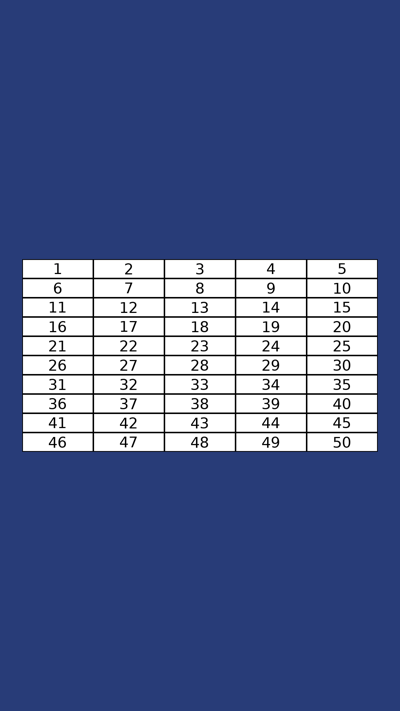

# 🔢 Gerador de Cartelas Numeradas

Script em Python que gera automaticamente imagens com grades de números (1 a 50, 51 a 100, e assim por diante) e pode encaixar cada grade dentro de uma arte pronta, feita no Photoshop ou no Canva.

Resolve um trabalho manual e repetitivo: em vez de montar dezenas de imagens uma por uma, o script gera todas de uma vez. Útil para bingos, sorteios, campanhas e listas numeradas.



## Funcionalidades

- Quantidade de números, números por cartela e colunas configuráveis
- Encaixe da grade numa arte `.png`, na posição e no tamanho que você escolher
- Números centralizados em cada célula
- Nomes de arquivo em sequência (`cartela_001.png`, `cartela_002.png`...)

## Tecnologias

Python 3 · Pillow · argparse

## Como usar

```bash
pip install pillow
```

**Só as grades**
```bash
python gerar_cartelas.py --total 4500 --por-cartela 50
```

**Encaixando na sua arte**
```bash
python gerar_cartelas.py --total 4500 --por-cartela 50 --layout arte.png --posicao 61 864 --tamanho 960 520
```

`--posicao` é o canto superior esquerdo onde a grade entra na arte, e `--tamanho` é a largura e a altura da grade. As imagens são salvas em `saida/`.

Veja todas as opções com:
```bash
python gerar_cartelas.py --help
```

## Autor

**José Augusto** · [LinkedIn](https://www.linkedin.com/in/josearraes)
